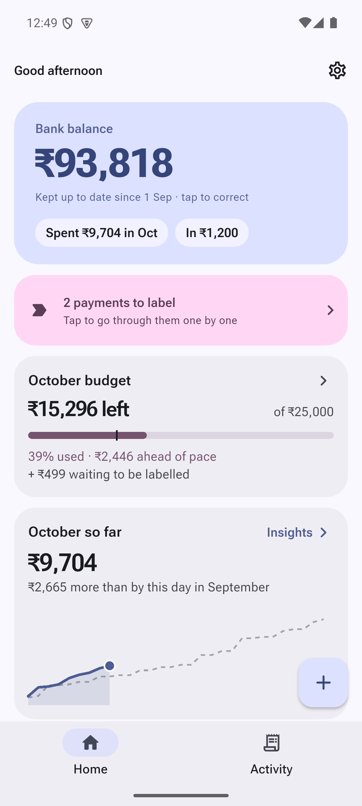
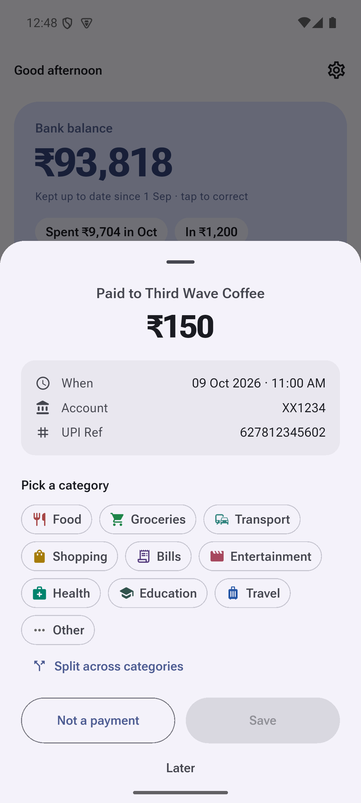
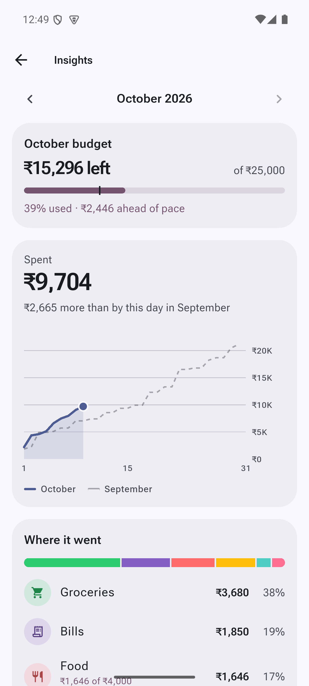
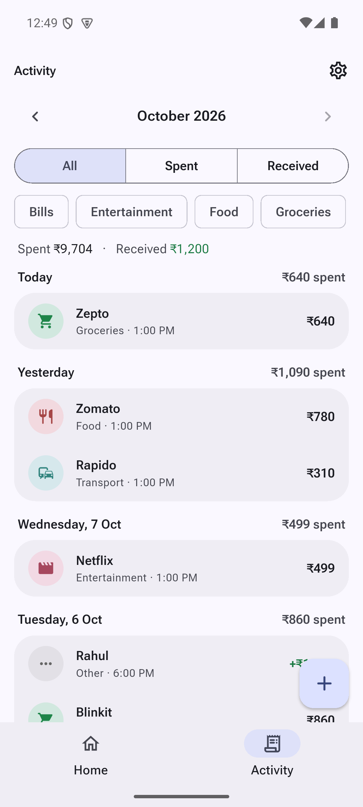

# PaiPai

**A local-first expense tracker for Android that labels your payments in one tap.**

Every UPI payment, card swipe and bank transfer already sends you a notification. PaiPai reads those notifications (bank SMS, UPI apps, bank apps, email receipts) on your phone and asks one question: *what was this?* Tap a category on the notification and it's filed, without opening the app.

No account. No server. No internet permission. Your data never leaves your phone.

<p align="center">
  
  
  
  
</p>

<p align="center"><sub>Screenshots use made-up demo data.</sub></p>

## Download

Get the latest APK from **[Releases](../../releases/latest)**, then follow [Installing](#installing) below.
Android 6.0 or newer. Not on the Play Store yet.

## What it does

- **Automatic payment capture.** Works with any bank or UPI app: bank SMS (through your Messages app), Google Pay, PhonePe, Paytm, bank apps and email receipts. It keeps working while the app is closed.
- **One-tap labelling.** Each payment brings a notification like *"₹250 paid · Swiggy"* with the two categories you usually pick for that shop. Tap one and it's saved. *More* opens a small card over whatever app you're in.
- **Never files anything on its own.** Past choices only order the suggestions, because the same shop can be groceries one day and a phone charger the next. You always choose.
- **Duplicates merged.** One payment often sends 2–3 alerts (bank app, SMS, email). They're merged by UPI reference, or by amount and time.
- **Budgets.** A monthly budget and optional category budgets, with alerts at 80% and 90% (you can change them) and when you go over.
- **Split payments.** One ₹3,000 supermarket bill can be groceries + snacks + toys.
- **Live bank balance.** Enter your balance once; it updates with every payment.
- **Insights.** Spending pace against last month, where the money went, and a spending calendar.
- **Home-screen widgets.** Label payments, this month so far, where it went, and quick add.
- **Backups.** A daily automatic backup to `Downloads/PaiPai` (it survives an uninstall), plus manual export and restore.
- **Material You.** Colors follow your wallpaper, light and dark.

## Privacy

- All data is stored in an SQLite database on your phone.
- The app asks for **no internet permission**, so it can't send anything anywhere.
- It reads notifications only to find payments; anything that isn't a payment (chats, OTPs, offers) is ignored and not stored.
- Backups are plain files that only you handle.
- The code is right here, so you can check all of this.

## Installing

PaiPai isn't on the Play Store yet, so Android shows a few warnings for a downloaded app. This is a one-time setup.

1. **Download** `PaiPai-x.y.z.apk` from [Releases](../../releases/latest) and open it.
2. **Allow installs** from your browser or Files app when Android asks.
3. **Play Protect** may say the app is unknown or unsafe (it hasn't seen it on the Play Store). Tap **More details → Install anyway**.
4. **Open PaiPai** and follow the setup screen. It asks for two things:
   - **Notifications**, so it can show *"₹250 paid"* alerts.
   - **Notification access**, so it can read payment notifications.
5. **If Notification access is greyed out** ("Restricted setting"): open **Settings → Apps → PaiPai → ⋮ (top right) → Allow restricted settings**, then turn on Notification access again.
6. **Android 15:** some bank SMS may show as *"Sensitive notification content hidden"*. The setup screen explains the one-time fix.

**Updating:** install the new APK over the old one. Your data stays.

## Missed a payment?

Banks change their message formats. If PaiPai missed or misread a payment, [open a "Missed payment" issue](../../issues/new/choose) and paste the message, with **your account number, name and reference numbers changed or removed**. Every message reported goes into the test library so it's caught from then on.

## Building from source

Requires Flutter 3.44 (stable) and the Android SDK.

```bash
flutter pub get
flutter analyze
flutter test
flutter run                  # on a device or emulator
flutter build apk --debug    # a debug APK you can install
```

Release builds are signed with the maintainer's private key and need `android/key.properties`, which isn't in the repo. To make your own release build, create a keystore and point `android/key.properties` at it (`storeFile`, `storePassword`, `keyAlias`, `keyPassword`). Note that an APK signed with a different key can't update the official one.

How the code is organised: see [`CLAUDE.md`](CLAUDE.md) (architecture and rules) and [`progress.md`](progress.md) (roadmap).

## Contributing

Bug reports, missed payment formats and pull requests are welcome. Please read [CONTRIBUTING.md](CONTRIBUTING.md) first.

## License

PaiPai is free software under the [GNU General Public License v3.0](LICENSE): you can use, study, change and share it, and anything you distribute that's built on it must stay open under the same license.

The name "PaiPai" and its logo identify the official app. Forks are welcome, but please give yours a different name and icon.
